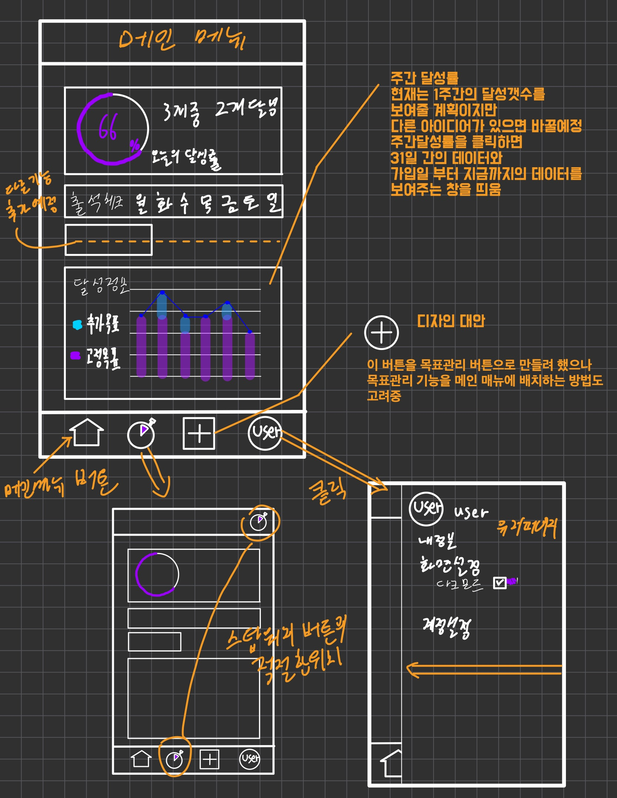
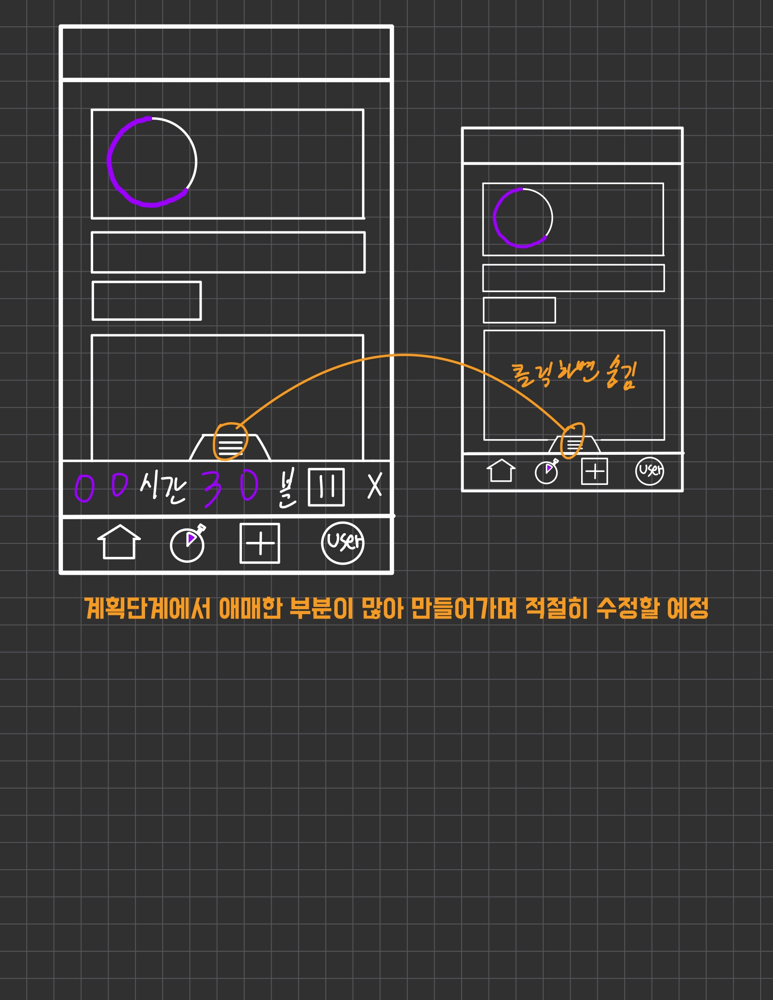

<p align="center">
  <strong>📋 TODO LIST 2.0</strong>
</p>

<p align="center">
  <a href="#ko">🇰🇷 한국어</a>
  &nbsp;|&nbsp;
  <a href="#ja">🇯🇵 日本語</a>
</p>

---

<span id="ko"></span>

## 🇰🇷 한국어

### 프로젝트 소개

React + Vite로 구축한 할일 관리 웹 애플리케이션입니다. 사용자 인증, 태스크 CRUD, Google 로그인 연동 기능을 지원합니다.

### 기술 스택

| 구분 | 기술 |
|------|------|
| 프론트엔드 | React, Vite |
| 백엔드 | Node.js, Express |
| 데이터베이스 | MySQL *(원래 AWS RDS에서 운영했으나 비용 문제로 인스턴스 삭제됨)* |

> ⚠️ **데이터베이스 안내**  
> 본 프로젝트는 원래 AWS RDS(MySQL)를 사용했습니다. 운영 비용이 발생하여 인스턴스를 삭제한 상태입니다. 로컬 또는 별도 MySQL 서버를 구성해야 합니다. 복원 스크립트는 `bEnd/quary/db-restore.sql` 에서 확인할 수 있습니다.

### 프로젝트 구조

```
TODOV2/
├── loc/          # 프론트엔드 (React + Vite)
├── bEnd/         # 백엔드 (Express)
│   ├── config/   # DB 설정
│   ├── routes/   # API 라우트
│   └── quary/    # SQL 스크립트
└── README.md
```

### 실행 방법

```bash
# 프론트엔드
cd loc && npm install && npm run dev

# 백엔드
cd bEnd && npm install && npm run dev
```

### 스크린샷

<p display='flex'>
  
  
</p>

---

<span id="ja"></span>

## 🇯🇵 日本語

### プロジェクト概要

React + Viteで構築したTodo管理Webアプリケーションです。ユーザー認証、タスクのCRUD、Googleログイン連携に対応しています。

### 技術スタック

| 種類 | 技術 |
|------|------|
| フロントエンド | React, Vite |
| バックエンド | Node.js, Express |
| データベース | MySQL *(元はAWS RDSで運用していたが、コストのためインスタンスを削除済み)* |

> ⚠️ **データベースについて**  
> 本プロジェクトは当初AWS RDS(MySQL)を使用していました。運用コストが発生するため、インスタンスを削除した状態です。ローカルまたは別途MySQLサーバーの構築が必要です。復元スクリプトは `bEnd/quary/db-restore.sql` で確認できます。

### プロジェクト構成

```
TODOV2/
├── loc/          # フロントエンド (React + Vite)
├── bEnd/         # バックエンド (Express)
│   ├── config/   # DB設定
│   ├── routes/   # APIルート
│   └── quary/    # SQLスクリプト
└── README.md
```

### 実行方法

```bash
# フロントエンド
cd loc && npm install && npm run dev

# バックエンド
cd bEnd && npm install && npm run dev
```

### スクリーンショット

<p display='flex'>
  
  
</p>

---

<p align="center">
  <sub>
    <a href="#ko">🇰🇷 한국어</a>
    &nbsp;·&nbsp;
    <a href="#ja">🇯🇵 日本語</a>
  </sub>
</p>
